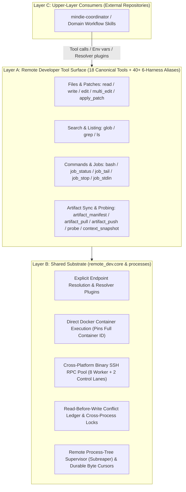

# `remote-dev` Architecture & Layered Design

[中文](./docs/design.zh.md) · **English** · [Documentation Index](./docs/README.en.md)

The goal of `remote-dev` is straightforward: **make working on a remote Linux server or inside a remote Docker container feel just like working in a local directory** for AI coding agents such as Codex, Claude Code, Cursor, Kimi Code, and Grok Build.

For local files, the agent uses the client's built-in `Read` / `Edit` / `Write` / `Bash` / `Glob` / `Grep` / `apply_patch` tools. For remote work, the agent calls the matching `remote.*` tool and simply adds the target endpoint (`host` / `port` / `container` / `alias`).



---

## How the Three Layers Work Together

### 1. Layer A: Remote Developer Tool Surface

Exposes 18 canonical tools (plus 40+ 6-Harness aliases across Codex, Claude Code, Cursor, Kimi Code, DSH, and Antigravity) over both the stdio MCP server (`remote-dev server`) and the CLI (`remote-dev <subcommand>`):
- **Read, Write & Patch**: `remote.read`, `remote.write`, `remote.edit`, `remote.multi_edit`, `remote.apply_patch`
- **Search & Browse**: `remote.glob`, `remote.grep`, `remote.ls`
- **Run & Control Processes**: `remote.bash`, `remote.job_status`, `remote.job_tail`, `remote.job_stop`, `remote.job_stdin`
- **Sync Files & Inspect Hosts**: `remote.artifact_manifest`, `remote.artifact_pull`, `remote.artifact_push`, `remote.probe`, `remote.context_snapshot`

### 2. Layer B: Shared Substrate

Handles connection management, container routing, and safety guarantees under the hood:
- **Explicit Target Resolution** (`remote_dev.core.endpoint`): Resolves targets from explicit arguments (`host` / `port` / `alias` or registered plugin selectors) or configured `default_alias` in `endpoints.json` / `~/.mindie-coordinator/endpoints.json` — never guessing from your local working directory.
- **Zero-Daemon Docker Container Execution** (`remote_dev.core.container_endpoint`): When you pass a container name or short ID, `remote-dev` resolves it to the running **full 64-character container ID** via the host's RPC channel and pins that full ID for all job records, read ledgers, and pooled connections. Even if someone recreates a container with the same name later, existing records never get mixed up.
- **Pooled Binary SSH RPC with Dedicated Control Lanes** (`remote_dev.core.rpc_transport`): Reuses persistent SSH connections on macOS, Linux, and native Windows. Both the MCP server and the remote RPC pool allocate **8 regular workers (32 slots)** and **2 reserved control workers (8 slots)** so `job_status`, `job_tail`, `job_stop`, and `job_stdin` always respond immediately even when regular workers are saturated.
- **No Blind Retries on Uncertain Outcomes**: If a connection drops mid-flight and `remote-dev` cannot confirm whether the remote operation ran, it reports `uncertain` instead of automatically replaying a potentially mutating command.
- **Read-Before-Write Conflict Protection** (`remote_dev.core.read_ledger`): Once a file has been read in the current session, subsequent edits or writes verify its SHA-256 hash so your agent never silently overwrites concurrent changes on the server.
- **Clean Process-Tree Termination & UTF-8 Safe Log Cursors** (`remote_dev.processes.control`, `remote_dev.core.job_ops`): On Linux, the remote worker runs as a child subreaper so `job_stop` cleanly terminates the entire process family (including grandchild processes). Output cursors advance under a lock and never split multi-byte UTF-8 characters across reads.
- **Chunked File Sync with SHA-256 Verification** (`remote_dev.core.artifact_ops`): Streams files in bounded 1 MiB chunks and performs atomic replacement only after verifying SHA-256 digests.

`ssh_command` is the single command constructor. For container endpoints, it invokes `docker exec -i <full-container-id>` over the host SSH connection — no SSH server, background daemon, or extra package installation is needed inside the container.

### 3. Layer C: Upper-Layer Consumers

Coordinators (like `mindie-coordinator`) and workflow skills live in their own repositories and interact with `remote-dev` strictly through tool calls, environment variables, and registered resolver plugins. `remote-dev` never imports Layer C.

---

## Minimal Dependencies

`remote-dev` depends only on:
1. **Python standard library** (`>= 3.11`)
2. **`mindie-diagnostics`** (for bounded local structured logging)
3. **An `ssh` client binary**

---

## MCP Transport & Resource URIs

The MCP server supports standard stdio `Content-Length` JSON-RPC framing as well as newline-delimited JSON-RPC. In addition to the 18 canonical tools (and 40+ 6-Harness aliases), it exposes read-only MCP resources:

- `remote://endpoints`
- `remote://endpoint/<endpoint-id>/context/latest`
- `remote://endpoint/<endpoint-id>/jobs`
- `remote://endpoint/<endpoint-id>/job/<job-id>/status`
- `remote://endpoint/<endpoint-id>/job/<job-id>/stdout`
- `remote://endpoint/<endpoint-id>/job/<job-id>/stderr`
- `remote://endpoint/<endpoint-id>/artifacts`
- `remote://endpoint/<endpoint-id>/artifacts/<artifact-id>/manifest`

---

## Local & Live Validation

Run the unit test suite and offline validator locally (no SSH server needed):

```bash
uv pip install -e ".[test]"
python -m pytest
remote-dev validate --local-only
```

To run end-to-end validation against a live SSH server:

```bash
remote-dev validate --host <host> --port <port> --root /srv/app --cwd /srv/app
```

See [Transport, Containers & Diagnostics](./docs/transport-and-diagnostics.en.md) for more details on container execution boundaries, resolver plugins, and connection diagnostics.
