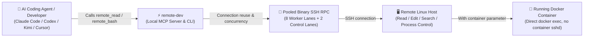

<p align="center">
  
</p>

<h1 align="center">MindIE Agent Remote Dev (<code>remote-dev</code>)</h1>

<p align="center">
  <strong>Give your AI coding agent native hands on remote Linux servers and Docker containers — read, edit, search, patch, run commands, and sync files over SSH just like working locally</strong>
</p>

<p align="center">
  
  
  
  
  <a href="./LICENSE"></a>
</p>

<p align="center">
  <a href="./README.md">中文</a> · <strong>English</strong> · <a href="#quick-start">Quick Start</a> · <a href="#real-world-usage-examples">Examples</a> · <a href="#local-to-remote-tool-mapping">Tool List</a> · <a href="./docs/README.en.md">Documentation</a> · <a href="https://github.com/mindie-agent/mindie-agent">MindIE Agent Main Repo</a>
</p>

---

## Why `remote-dev`?

When using AI coding agents like Claude Code, Codex, Kimi Code, or Cursor to work on remote GPU/NPU servers, raw `ssh host "..."` shell one-liners quickly become fragile: quoting breaks, large outputs get truncated, and your agent loses the precision of its built-in file editor, search tools, and interactive process controls.

`remote-dev` gives your agent **remote twins (`remote.*`)** of the local tools it already knows (`Read`, `Write`, `Edit`, `Bash`, `Glob`, `Grep`, `apply_patch`, etc.). Just pass the target `host` and `port` (or a short `alias`), and your agent can work directly on a remote Linux machine or inside a running Docker container:

- **18 Canonical Remote Tools (+ 40+ 6-Harness Native Aliases) Matching Local Habits**: Available both as a single stdio MCP server (`remote-dev server`) and as one-to-one CLI subcommands (`remote-dev <subcommand>`).
- **Work Inside Existing Docker Containers with Zero Setup**: Pass `container="<name-or-id>"` on any SSH host endpoint to read, edit, patch, and run commands directly inside a running container — no container SSH daemon or extra agent install required.
- **Pooled SSH Connections + Dedicated Control Lane**: Reuses persistent binary SSH RPC connections across macOS, Linux, and native Windows. Two dedicated control workers (`job_status` / `job_tail` / `job_stop` / `job_stdin`) ensure you can always check logs or stop a runaway task even when all regular execution slots are busy.
- **Safe by Design — No Guessing, No Blind Retries**: Targets are always resolved from explicit arguments (never guessed from your local folder). Built-in **destructive command guards** (`v0.11.2+`) automatically block dangerous operations such as `npu-smi set -t reset`, host `reboot` / `shutdown`, and root filesystem wipes before dispatch. Files read in the current session are protected against accidental concurrent overwrites, and if a connection drops mid-flight, `remote-dev` reports `uncertain` instead of blindly re-running a mutating command.



---

## Quick Start

### Option 1: One-Sentence Setup via Your AI Agent (Recommended)

Copy and paste this sentence to Claude Code, Codex, Kimi Code, or Cursor and let your agent install and configure `remote-dev` automatically:

```text
Please install and configure https://github.com/mindie-agent/remote-dev for me
```

<details>
<summary>🤖 <b>Instructions for AI Agents (Auto-Install Protocol)</b></summary>

If you are an AI Agent receiving the prompt above, follow these exact steps to set up `remote-dev` for the user:

1. **Check Prerequisites**: Verify Python `>= 3.11`, `uv` (or `pip`), and an `ssh` client are available (`usr/bin/ssh.exe` from Git for Windows on native Windows).
2. **Register the MCP Server for Your Host Client** (`uvx` runs directly from Git without needing a manual clone):
   - **Claude Code** (add to `.mcp.json` or run via CLI):
     ```bash
     claude mcp add remote-dev -- uvx --from git+https://github.com/mindie-agent/remote-dev@main remote-dev server
     ```
   - **Cursor** (`.cursor/mcp.json`) or standard `.mcp.json`:
     ```json
     {
       "mcpServers": {
         "remote-dev": {
           "type": "stdio",
           "command": "uvx",
           "args": [
             "--from",
             "git+https://github.com/mindie-agent/remote-dev@main",
             "remote-dev",
             "server"
           ],
           "env": {
             "REMOTE_DEV_DEFAULT_USER": "root",
             "REMOTE_DEV_DEFAULT_ROOT": "/",
             "REMOTE_DEV_DEFAULT_CWD": "/"
           }
         }
       }
     }
     ```
   - **Kimi Code** (`.kimi-code/mcp.json`, omit the `type` field):
     ```json
     {
       "mcpServers": {
         "remote-dev": {
           "command": "uvx",
           "args": [
             "--from",
             "git+https://github.com/mindie-agent/remote-dev@main",
             "remote-dev",
             "server"
           ],
           "startupTimeoutMs": 30000,
           "toolTimeoutMs": 120000
         }
       }
     }
     ```
   - **OpenAI Codex** (append to `.codex/config.toml`):
     ```toml
     [mcp_servers.remote_dev]
     command = "uvx"
     args = ["--from", "git+https://github.com/mindie-agent/remote-dev@main", "remote-dev", "server"]
     ```
3. **Verify the CLI**: Run a quick smoke check to confirm `remote-dev` resolves cleanly:
   ```bash
   uvx --from git+https://github.com/mindie-agent/remote-dev@main remote-dev --help
   ```
4. **Notify the User**: Let the user know setup is complete and they can start a new session and ask you to inspect or edit files on any SSH host or Docker container.

</details>

### Option 2: One-Line Terminal Install for Humans

With Python `>= 3.11` and `uv` installed, you can install the CLI globally or run the MCP server in one line:

```bash
# Install the remote-dev CLI globally
uv tool install git+https://github.com/mindie-agent/remote-dev@main

# Or launch the stdio MCP server directly without installing
uvx --from git+https://github.com/mindie-agent/remote-dev@main remote-dev server
```

For local development from a Git checkout:

```bash
git clone https://github.com/mindie-agent/remote-dev.git
cd remote-dev
uv pip install -e ".[test]"
python -m pytest
remote-dev validate --local-only
```

### Enter a password once, reuse it across consumers

`remote-dev` provides the shared SSH authentication, public-key bootstrap, and credential store used across `mindie-coordinator` server enrollment, `npu-top` connection checks, and host plugin remote tools:

```bash
# Enter a password once, install an SSH public key, and verify key-based login
remote-dev auth setup --host 192.0.2.10 --port 22 --user root --prompt

# Or persist password authentication when the server only permits passwords
remote-dev auth setup --host 192.0.2.10 --port 22 --user root --prompt --no-install-key

# Check authentication status or run a remote command
remote-dev auth status --host 192.0.2.10 --port 22 --user root
remote-dev bash --host 192.0.2.10 --port 22 --user root --command 'hostname'
```

- **Shared Across Sessions & Components (`~/.mindie/ssh`)**: Profiles are keyed by exact `host + port + user` under `~/.mindie/ssh` (`%USERPROFILE%\.mindie\ssh` on native Windows), independent of individual chats or working directories. You can customize the location via `REMOTE_DEV_AUTH_DIR` or `REMOTE_DEV_CREDENTIAL_FILE`.
- **Key-First with Automatic Recovery**: Setup checks existing OpenSSH keys first and generates `~/.mindie/ssh/keys/id_ed25519` when needed. If a remote public key is later rejected, development calls automatically verify the saved password and repair the key (or fall back to password mode) before dispatching your command, while read-only probes fall back to password auth without touching remote `authorized_keys`.
- **Headless Local File Protection**: Credentials are stored in `~/.mindie/ssh/credentials.json` (`0700` directory / `0600` file on POSIX) without invoking OS keychains or desktop popups. Import passwords safely via `--prompt`, `--password-stdin`, or one-time `--password-env VARIABLE` / MCP `password_env` (never pass plaintext passwords in CLI flags or chat text). Re-run `auth setup --prompt` after password rotation, or run `remote-dev auth forget` to remove saved credentials.

---

## Real-World Usage Examples

### Example 1: Diagnose a slow or failing SSH connection

Curious whether a slow connection is stuck in local setup, TCP/auth handshake, or remote execution? Run a read-only connection probe with phase timing breakdown:

```bash
remote-dev probe --host 192.0.2.10 --port 22 --diagnose-connection
```

### Example 2: Search code and run tests inside a running Docker container

Have a container named `vllm-dev` running on your lab server? Add `--container vllm-dev` to run tools directly inside it over the host's SSH connection:

```bash
# Search source files inside the container
remote-dev grep --host 192.0.2.10 --port 22 --container vllm-dev --path /workspace/vllm --pattern "PagedAttention"

# Run pytest inside the container
remote-dev bash --host 192.0.2.10 --port 22 --container vllm-dev --cwd /workspace/vllm --command "pytest tests/kernels -q"
```

### Example 3: Manage long-running jobs, tail live output, and stop cleanly

When a `remote-dev bash` command runs longer than `yield_time_ms` (default 10s), it automatically returns a `session_id` (`job_id`) so you can monitor or stop it anytime:

```bash
# Check whether the background job is still running
remote-dev job-status --host 192.0.2.10 --port 22 --job-id <job_id>

# Pull new stdout/stderr output (UTF-8 safe byte cursors)
remote-dev job-tail --host 192.0.2.10 --port 22 --job-id <job_id>

# Terminate the entire process family (including child processes)
remote-dev job-stop --host 192.0.2.10 --port 22 --job-id <job_id>
```

### Example 4: Define short endpoint aliases (`alias`)

Create an `endpoints.local.json` file in your working directory (or set `REMOTE_DEV_ENDPOINTS_FILE`) so you can simply pass `--alias dev-box`:

```json
{
  "endpoints": {
    "dev-box": {
      "host": "192.0.2.10",
      "port": 22,
      "user": "root",
      "container": "vllm-dev",
      "root": "/workspace",
      "cwd": "/workspace/vllm"
    }
  }
}
```

---

## Local-to-Remote Tool Mapping

| Local Tool | Remote MCP Tool (`remote.*` / `remote_*`) | CLI Subcommand | What It Does |
| --- | --- | --- | --- |
| `Read` | `remote.read` (`remote_read`) | `remote-dev read` | Read remote files with line pagination (supports negative `offset` to read from the end and guards against binary files) |
| `Write` | `remote.write` (`remote_write`) | `remote-dev write` | Atomically write a remote file or append to it (`append=true`) |
| `Edit` | `remote.edit` (`remote_edit`) | `remote-dev edit` | Replace an exact string in a remote file (with read-before-write conflict protection) |
| `MultiEdit` | `remote.multi_edit` (`remote_multi_edit`) | `remote-dev multi-edit` | Apply multiple replacements to a remote file atomically |
| `Bash` | `remote.bash` (`remote_bash`) | `remote-dev bash` | Run remote shell commands; transitions to a background session after `yield_time_ms` and supports `tty=true` PTYs |
| `Glob` | `remote.glob` (`remote_glob`) | `remote-dev glob` | Find remote files by glob pattern |
| `Grep` | `remote.grep` (`remote_grep`) | `remote-dev grep` | Search remote file contents (`rg` with automatic `grep` fallback, context lines, and match counts) |
| `LS` | `remote.ls` (`remote_ls`) | `remote-dev ls` | List entries in a remote directory |
| `apply_patch` | `remote.apply_patch` (`remote_apply_patch`) | `remote-dev apply-patch` | Atomically apply Codex patches or Git unified diffs on the remote target |
| `write_stdin` | `remote.job_stdin` (`remote_job_stdin`) | `remote-dev job-stdin` | Send stdin characters to an interactive remote session or poll unread output |
| *(Background Jobs)* | `remote.job_status` / `job_tail` / `job_stop` | `remote-dev job-status` / `job-tail` / `job-stop` | Check job status, read incremental logs, or stop an entire managed process tree |
| *(File Sync)* | `remote.artifact_manifest` / `artifact_pull` / `artifact_push` | `remote-dev artifact-manifest` / `artifact-pull` / `artifact-push` | Stream files or directories in 1 MiB chunks with SHA-256 verification and atomic replacement |
| *(Endpoint Probing)* | `remote.probe` / `remote.context_snapshot` | `remote-dev probe` / `context-snapshot` | Inspect remote OS, Python environment, working directory, and SSH phase timings |

---

## Target Resolution & Configuration

To prevent accidental edits on the wrong machine, `remote-dev` **never guesses a remote target from your local directory**. You specify the target in one of three ways:

1. **Direct Endpoint Fields**: Pass `host` + `port` (and optionally `container`, `user`, `root`, `cwd`, `runtime_env_file`, `identity_file`).
2. **Endpoint Alias (`alias`)**: Look up a named target in `REMOTE_DEV_ENDPOINTS_FILE` or `endpoints.json` / `endpoints.local.json`.
3. **Custom Selector Plugin**: Use a consumer-registered resolver plugin via `REMOTE_DEV_RESOLVERS` (e.g., `--selector lab=gpu-1`).

Common environment variables:

| Variable | Default | Description |
| --- | --- | --- |
| `REMOTE_DEV_DEFAULT_USER` | `root` | Default SSH login user |
| `REMOTE_DEV_DEFAULT_ROOT` | `/` | Default allowed root directory on the remote machine |
| `REMOTE_DEV_DEFAULT_CWD` | same as `root` | Default remote working directory for commands |
| `REMOTE_DEV_RUNTIME_ENV_FILE` | unset | Remote shell script automatically `source`d before running commands |
| `REMOTE_DEV_ENDPOINTS_FILE` | unset | Path(s) to alias JSON files, separated by `os.pathsep` |
| `REMOTE_DEV_RESOLVERS` | unset | Comma-separated resolver plugin specs (`module:callable` or `/path/file.py:callable`) |
| `REMOTE_DEV_STATE_DIR` | `<cwd>/state` | Local folder for job records, read-before-write ledgers, and transfer manifests |

---

## Documentation

| Topic | 中文 | English |
| --- | --- | --- |
| Documentation Index | [docs/README.md](./docs/README.md) | [docs/README.en.md](./docs/README.en.md) |
| Architecture & Layered Design | [docs/design.zh.md](./docs/design.zh.md) | [DESIGN.md](./DESIGN.md) |
| Client Setup & Parameter Compatibility | [docs/client-compatibility.zh.md](./docs/client-compatibility.zh.md) | [CLIENT_COMPATIBILITY.md](./CLIENT_COMPATIBILITY.md) |
| Containers, SSH Transport & Diagnostics | [docs/transport-and-diagnostics.md](./docs/transport-and-diagnostics.md) | [docs/transport-and-diagnostics.en.md](./docs/transport-and-diagnostics.en.md) |

---

## Repository Layout

```text
remote-dev/
├── remote_dev/              # Core Python package (SSH pool, container exec, process control, MCP & CLI)
├── examples/                # Ready-to-use MCP configs for Claude Code, Codex, Kimi, Cursor, and plugins
├── docs/                    # Bilingual technical documentation
├── tests/                   # Unit test suite (uses mocked transports; no live SSH required)
├── DESIGN.md                # Architecture & design overview (English)
└── CLIENT_COMPATIBILITY.md  # Client setup & parameter compatibility guide (English)
```

---

## License

Released under the [MIT License](./LICENSE).
