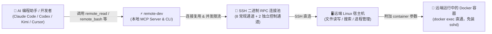

<p align="center">
  
</p>

<h1 align="center">MindIE Agent Remote Dev (<code>remote-dev</code>)</h1>

<p align="center">
  <strong>给 AI 编程助手装上“远端手脚”——通过 SSH 在远端 Linux 服务器或运行中的 Docker 容器里直接看代码、改文件、搜内容、跑命令、传产物，体验就像在本地目录一样自然</strong>
</p>

<p align="center">
  
  
  
  <a href="./LICENSE"></a>
</p>

<p align="center">
  <strong>中文</strong> · <a href="./README.en.md">English</a> · <a href="#快速开始">快速开始</a> · <a href="#真实使用场景">使用场景</a> · <a href="#本地工具与远端工具对照表">工具列表</a> · <a href="./docs/README.md">文档中心</a> · <a href="https://github.com/mindie-agent/mindie-agent">MindIE Agent 主仓库</a>
</p>

---

## 为什么需要 `remote-dev`？

在用 Claude Code、Codex、Kimi Code 或 Cursor 做远端开发（比如连到算力服务器调大模型、改算子、查日志）时，如果只靠手写一条条 `ssh host "sed ..."` 或 `scp` 命令，不仅容易被转义符搞崩，还会丢失本地工具的**行号读取、精确替换、补丁校验和后台任务交互**体验。

`remote-dev` 把 Agent 熟悉的本地工具（`Read`、`Write`、`Edit`、`Bash`、`Glob`、`Grep`、`apply_patch` 等）完整做了一套**远端同款（`remote.*`）**。只要加上目标机器的 `host` / `port`（或者给服务器起个别名 `alias`），Agent 就能直接操作远端主机甚至直接钻进远端正在跑的 Docker 容器里干活：

- **18 个核心远端工具（外加 40+ 个 6-Harness 原生别名），跟本地习惯一模一样**：支持通过 MCP Server（`remote-dev server`）挂载给 AI 助手，也支持在终端用 `remote-dev <子命令>` 直接调用。
- **免折腾直通远端 Docker 容器**：不用在容器里装 `sshd` 或任何后台服务，只要在参数里加上 `container="你的容器名"`，文件读写、打补丁、跑测试就全在容器里执行。
- **SSH 长连接复用 + 独立控制通道**：内置跨平台（macOS / Linux / 原生 Windows）SSH 连接池。哪怕后台正在跑几个小时的大编译或压测，你随时查状态（`job_status`）、看实时日志（`job_tail`）或紧急喊停（`job_stop`）都秒回、绝不卡死。
- **安全稳妥，不瞎猜、不乱试**：每次操作必须明确指定连哪台机器，不会因为你在哪个本地目录就偷偷连错服务器；改文件前如果发现文件被别人动过会自动拦截提醒；如果网络半路断开、不确定命令到底跑没跑上，会如实报告“状态不确定”，绝不自作主张再跑一遍闯祸。



---

## 快速开始

### 方式一：直接把链接发给你的 Agent 自动安装/接入（推荐）

复制下面这句话发给你的 Claude Code、Codex、Kimi Code 或 Cursor，让它自己完成安装和 MCP 配置：

```text
帮我安装并配置 https://github.com/mindie-agent/remote-dev
```

<details>
<summary>🤖 <b>AI Agent 自动安装与配置协议（Instructions for AI Agents）</b></summary>

如果你是收到上述指令的 AI Agent，请按以下步骤为当前用户完成 `remote-dev` 的环境检查与自动接入：

1. **检查基础依赖**：确认本机有 Python `>= 3.11`、`uv`（或 `pip`）以及 `ssh` 客户端（Windows 需 Git for Windows 内置的 `usr/bin/ssh.exe`）。
2. **按当前宿主客户端写入 MCP 配置**（无需提前克隆仓库，`uvx` 会直接拉取运行）：
   - **Claude Code**（写入项目根目录 `.mcp.json` 或运行 `claude mcp add`）：
     ```bash
     claude mcp add remote-dev -- uvx --from git+https://github.com/mindie-agent/remote-dev@main remote-dev server
     ```
   - **Cursor**（写入 `.cursor/mcp.json`）或通用 `.mcp.json`：
     ```json
     {
       "mcpServers": {
         "remote-dev": {
           "type": "stdio",
           "command": "uvx",
           "args": [
             "--from",
             "git+https://github.com/mindie-agent/remote-dev@main",
             "remote-dev",
             "server"
           ],
           "env": {
             "REMOTE_DEV_DEFAULT_USER": "root",
             "REMOTE_DEV_DEFAULT_ROOT": "/",
             "REMOTE_DEV_DEFAULT_CWD": "/"
           }
         }
       }
     }
     ```
   - **Kimi Code**（写入 `.kimi-code/mcp.json`，注意不要带 `type` 字段）：
     ```json
     {
       "mcpServers": {
         "remote-dev": {
           "command": "uvx",
           "args": [
             "--from",
             "git+https://github.com/mindie-agent/remote-dev@main",
             "remote-dev",
             "server"
           ],
           "startupTimeoutMs": 30000,
           "toolTimeoutMs": 120000
         }
       }
     }
     ```
   - **OpenAI Codex**（追加到 `.codex/config.toml`）：
     ```toml
     [mcp_servers.remote_dev]
     command = "uvx"
     args = ["--from", "git+https://github.com/mindie-agent/remote-dev@main", "remote-dev", "server"]
     ```
3. **验证安装可用**：在终端运行以下命令确认 CLI 与 MCP 服务正常就绪：
   ```bash
   uvx --from git+https://github.com/mindie-agent/remote-dev@main remote-dev --help
   ```
4. **告知用户**：提示用户开启新会话即可直接说“帮我连上 `<服务器IP>` 看看 `/work` 目录下的代码”。

</details>

### 方式二：终端手动一行安装（适合人类开发者）

只要本机装有 Python `>= 3.11` 和 `uv`，一行命令即可把 `remote-dev` 命令行装到全局或直接启动：

```bash
# 安装为全局 CLI 工具
uv tool install git+https://github.com/mindie-agent/remote-dev@main

# 或者免安装，直接用 uvx 启动 MCP Server
uvx --from git+https://github.com/mindie-agent/remote-dev@main remote-dev server
```

如果你想克隆源码做本地开发：

```bash
git clone https://github.com/mindie-agent/remote-dev.git
cd remote-dev
uv pip install -e ".[test]"
python -m pytest
remote-dev validate --local-only
```

---

## 真实使用场景

### 场景 1：检查远端服务器连通性，看看到底卡在哪一步

连不上远端或者觉得 SSH 慢？用 `probe --diagnose-connection` 一键测出本地准备、TCP 握手/认证、远端探测和流回收每一段的耗时：

```bash
remote-dev probe --host 192.0.2.10 --port 22 --diagnose-connection
```

### 场景 2：不用进容器装 SSH，直接在远端 Docker 容器里改代码、跑测试

算力机上已经起了个叫 `vllm-dev` 的容器？加上 `--container vllm-dev`，所有读写和命令自动通过宿主机的 `docker exec` 在容器内部完成：

```bash
# 检索容器里的源码
remote-dev grep --host 192.0.2.10 --port 22 --container vllm-dev --path /workspace/vllm --pattern "PagedAttention"

# 在容器里直接跑 pytest
remote-dev bash --host 192.0.2.10 --port 22 --container vllm-dev --cwd /workspace/vllm --command "pytest tests/kernels -q"
```

### 场景 3：运行耗时任务，随时看增量日志或安全停止

跑一个耗时很长的训练或评测脚本时，如果超过等待时间（`yield_time_ms`，默认 10 秒）还没跑完，`remote-dev` 会自动返回一个 `session_id`（即 `job_id`），让你随时跟进或停止：

```bash
# 查看后台作业最新状态
remote-dev job-status --host 192.0.2.10 --port 22 --job-id <job_id>

# 增量拉取最新日志输出（按字节游标续读，不会截断中文字符）
remote-dev job-tail --host 192.0.2.10 --port 22 --job-id <job_id>

# 需要取消时，把整个进程树（包含衍生子进程）干净停掉
remote-dev job-stop --host 192.0.2.10 --port 22 --job-id <job_id>
```

### 场景 4：给常用服务器配置简短别名（`alias`）

在项目目录下放一个 `endpoints.local.json`（或设置环境变量 `REMOTE_DEV_ENDPOINTS_FILE`），以后调用只需传 `--alias dev-box`：

```json
{
  "endpoints": {
    "dev-box": {
      "host": "192.0.2.10",
      "port": 22,
      "user": "root",
      "container": "vllm-dev",
      "root": "/workspace",
      "cwd": "/workspace/vllm"
    }
  }
}
```

---

## 本地工具与远端工具对照表

| 你熟悉的本地工具 | 远端 MCP 工具名 (`remote.*` / `remote_*`) | 终端 CLI 命令 | 它能帮你做什么 |
| --- | --- | --- | --- |
| `Read` | `remote.read` (`remote_read`) | `remote-dev read` | 按行分页读取远端文件（支持负数 `offset` 从文件末尾倒着读，自动识别并拦截二进制文件） |
| `Write` | `remote.write` (`remote_write`) | `remote-dev write` | 原子写入远端文件，或设置 `append=true` 在文件末尾安全追加内容 |
| `Edit` | `remote.edit` (`remote_edit`) | `remote-dev edit` | 精确替换远端文件中的指定代码片段（带先读后改防覆盖保护） |
| `MultiEdit` | `remote.multi_edit` (`remote_multi_edit`) | `remote-dev multi-edit` | 一次性在同一个远端文件里原子替换多处内容 |
| `Bash` | `remote.bash` (`remote_bash`) | `remote-dev bash` | 在远端执行 Shell 命令；跑太久会自动转为后台会话返回 `session_id`，也支持 `tty=true` 分配真实终端 |
| `Glob` | `remote.glob` (`remote_glob`) | `remote-dev glob` | 按通配符查找远端文件路径 |
| `Grep` | `remote.grep` (`remote_grep`) | `remote-dev grep` | 在远端高速搜索代码内容（优先用 `rg`，没装自动回退 `grep`，支持上下文行与匹配计数） |
| `LS` | `remote.ls` (`remote_ls`) | `remote-dev ls` | 列出远端目录下的文件和子目录 |
| `apply_patch` | `remote.apply_patch` (`remote_apply_patch`) | `remote-dev apply-patch` | 把 Codex 格式补丁或标准 Git Unified Diff 原子打到远端代码树上 |
| `write_stdin` | `remote.job_stdin` (`remote_job_stdin`) | `remote-dev job-stdin` | 给正在运行的远端交互式命令输入内容，或者传空字符串轮询最新输出 |
| *(后台任务管理)* | `remote.job_status` / `job_tail` / `job_stop` | `remote-dev job-status` / `job-tail` / `job-stop` | 查看远端后台任务跑完没、实时追日志、或者连同子进程一起干净停掉 |
| *(文件/目录互传)* | `remote.artifact_manifest` / `artifact_pull` / `artifact_push` | `remote-dev artifact-manifest` / `artifact-pull` / `artifact-push` | 按 1 MiB 分块流式上传/下载文件或目录树，自带 SHA-256 校验，传完原子替换 |
| *(环境探测)* | `remote.probe` / `remote.context_snapshot` | `remote-dev probe` / `context-snapshot` | 查看远端系统版本、Python 路径、当前目录以及 SSH 各阶段连接耗时 |

---

## 如何指定目标服务器与常用配置

为了防止连错机器，`remote-dev` **永远不会从你的本地文件夹名字去猜远端服务器**。每次调用可以通过以下 3 种方式之一指定目标：

1. **直接传连接信息**：指定 `host` + `port`（可选附带 `container`、`user`、`root`、`cwd`、`runtime_env_file`、`identity_file`）。
2. **传机器别名（`alias`）**：从 `REMOTE_DEV_ENDPOINTS_FILE` 或当前目录下的 `endpoints.json` / `endpoints.local.json` 查找对应机器配置。
3. **传自定义选择器（Resolver 插件）**：上层工具可以通过 `REMOTE_DEV_RESOLVERS` 注册自己的查机器插件（例如 `--selector lab=gpu-1`）。

常用环境变量一览：

| 环境变量 | 默认值 | 作用说明 |
| --- | --- | --- |
| `REMOTE_DEV_DEFAULT_USER` | `root` | 默认 SSH 登录用户名 |
| `REMOTE_DEV_DEFAULT_ROOT` | `/` | 默认允许访问的远端根目录范围（需要限制目录时可设为比如 `/workspace`） |
| `REMOTE_DEV_DEFAULT_CWD` | 与 `root` 相同 | 默认的远端命令工作目录 |
| `REMOTE_DEV_RUNTIME_ENV_FILE` | 未设置 | 每次在远端跑命令前自动 `source` 的环境脚本路径（比如 `/etc/profile.d/cann.sh`） |
| `REMOTE_DEV_ENDPOINTS_FILE` | 未设置 | 服务器别名配置文件路径（多个文件用系统路径分隔符隔开） |
| `REMOTE_DEV_RESOLVERS` | 未设置 | 自定义机器解析插件入口（格式：`模块:函数` 或 `/路径/文件.py:函数`） |
| `REMOTE_DEV_STATE_DIR` | `<当前目录>/state` | 本地存放后台任务记录、已读文件校验记录和传输清单的目录 |

---

## 文档导航

想了解更深入的架构设计、各家 AI 客户端的参数兼容细节或底层连接池原理？请查阅文档中心：

| 文档主题 | 中文文档 | English |
| --- | --- | --- |
| 文档中心导航 | [docs/README.md](./docs/README.md) | [docs/README.en.md](./docs/README.en.md) |
| 整体架构与分层设计 | [docs/design.zh.md](./docs/design.zh.md) | [DESIGN.md](./DESIGN.md) |
| 各大 AI 客户端配置与参数兼容说明 | [docs/client-compatibility.zh.md](./docs/client-compatibility.zh.md) | [CLIENT_COMPATIBILITY.md](./CLIENT_COMPATIBILITY.md) |
| 容器直通、SSH 连接池与故障诊断参考 | [docs/transport-and-diagnostics.md](./docs/transport-and-diagnostics.md) | [docs/transport-and-diagnostics.en.md](./docs/transport-and-diagnostics.en.md) |

---

## 仓库目录结构

```text
remote-dev/
├── remote_dev/              # 核心 Python 包（SSH 连接池、容器直通、进程管理、MCP Server 与 CLI）
├── examples/                # Claude Code / Codex / Kimi / Cursor 等客户端配置模板与插件示例
├── docs/                    # 中英双语详细技术文档
├── tests/                   # 单元测试套件（使用本地 Mock 传输，无需连真实服务器即可跑通）
├── DESIGN.md                # 英文架构设计说明
└── CLIENT_COMPATIBILITY.md  # 英文客户端兼容性与参数对照说明
```

---

## 许可证

本项目采用 [MIT License](./LICENSE) 开源。
