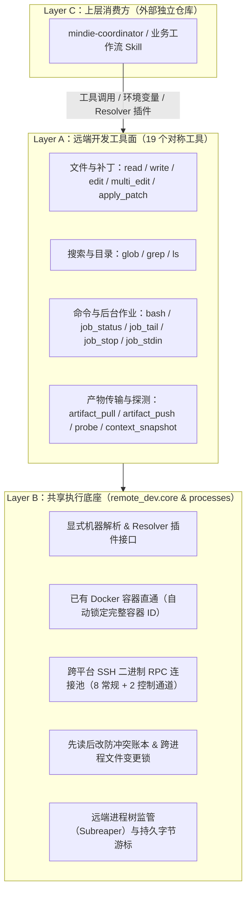

# `remote-dev` 架构与分层设计

**中文** · [English](../DESIGN.md) · [返回文档中心](./README.md)

`remote-dev` 的核心目标很简单：**让 AI 编程助手（Codex、Claude Code、Cursor、Kimi Code、Grok Build 等）在远端 Linux 服务器或 Docker 容器上干活时，体验跟改本地代码一模一样。**

平时改本地文件，Agent 用客户端自带的 `Read` / `Edit` / `Write` / `Bash` / `Glob` / `Grep` / `apply_patch`；一旦要操作远端服务器，Agent 只需改调同名的 `remote.*` 工具，外加指明连哪台服务器（`host` / `port` / `container` / `alias`）即可。



---

## 三层架构是怎么分工的？

### 1. 工具表面层（Layer A：面向 Agent 的 19 个工具）

把 Agent 最熟悉的操作一对一暴露为 MCP 工具和 CLI 子命令：
- **读写与改代码**：`remote.read`、`remote.write`、`remote.edit`、`remote.multi_edit`、`remote.apply_patch`
- **找文件与搜代码**：`remote.glob`、`remote.grep`、`remote.ls`
- **跑命令与管后台任务**：`remote.bash`、`remote.job_status`、`remote.job_tail`、`remote.job_stop`、`remote.job_stdin`
- **传大文件与探测环境**：`remote.artifact_manifest`、`remote.artifact_pull`、`remote.artifact_push`、`remote.probe`、`remote.context_snapshot`

### 2. 共享执行底座（Layer B：脏活累活全包揽）

所有工具共享同一套底层通信与安全保护能力：
- **明确的目标机器解析**（`remote_dev.core.endpoint`）：只认显式传入的 `host` / `port` / `alias` 或自定义插件选择器，绝不瞎猜。
- **远端 Docker 容器直通**（`remote_dev.core.container_endpoint`）：当你传入容器名字或短 ID 时，底座会先通过宿主机查出正在运行的**完整 64 位容器 ID** 并将其锁定。后续读写文件、记账、复用连接全都认准这个完整 ID，哪怕外面有人删了重建同名容器，也不会串台。
- **SSH 二进制连接池与控制通道隔离**（`remote_dev.core.rpc_transport`）：在 Windows、macOS 和 Linux 上复用长连接。MCP Server 和远端 RPC 都专门划分了 **8 个常规工作通道（32 槽位）** 和 **2 个独立控制通道（8 槽位）**——这样即使常规通道全在跑耗时操作，`job_status`、`job_tail`、`job_stop` 依然能走控制通道立刻响应。
- **网络断开绝不盲目重试**：如果请求发出去后连接突然中断、无法确认远端到底执行了没有，底座会直接返回“结果不确定（`uncertain`）”，绝不偷偷重跑命令。
- **先读后改防覆盖保护**（`remote_dev.core.read_ledger`）：如果 Agent 在当前会话里读过某个文件，再去改它时底座会自动核对文件的 SHA-256 哈希，防止把别人刚改的内容冲掉。
- **远端进程树收割与日志游标**（`remote_dev.processes.control`、`remote_dev.core.job_ops`）：Linux 远端 Worker 会把自己设为子进程收养人（Subreaper），停任务时把派生的所有孙子进程一起清理干净；日志按持久化的字节游标读取，绝不会把多字节的 UTF-8 中文截成乱码。
- **大文件分块校验传输**（`remote_dev.core.artifact_ops`）：按 1 MiB 分块传输，全部传完并核对 SHA-256 无误后才原子替换目标文件。

`ssh_command` 是底层拼装 SSH 命令的唯一入口。对于容器目标，它直接在宿主机 SSH 里通过 `docker exec -i <完整容器ID>` 启动 Python Worker 或命令，**不需要你在容器里装 SSH 服务或任何守护进程**。

### 3. 上层消费方（Layer C：外部调度器与业务流）

像 `mindie-coordinator` 或各类业务 Skill 都属于上层消费方，住在它们自己的仓库里，只通过调用工具、传环境变量或注册 Resolver 插件来使用 `remote-dev`。`remote-dev` 自身保持纯粹，绝不反向依赖任何上层业务包。

---

## 极简依赖

`remote-dev` 运行时只依赖：
1. **Python 标准库**（`>= 3.11`）
2. **`mindie-diagnostics`**（用于本地结构化诊断日志）
3. **系统自带的 `ssh` 客户端**

---

## MCP 传输协议与资源 URI

MCP Server（`remote-dev server`）同时支持标准的 `Content-Length` JSON-RPC 帧协议和按行分隔的 JSON-RPC 消息。除 19 个工具外，还暴露了只读 MCP 资源供客户端按 URI 订阅查看：

- `remote://endpoints`：已知远端端点列表
- `remote://endpoint/<endpoint-id>/context/latest`：端点最新环境快照
- `remote://endpoint/<endpoint-id>/jobs`：该端点上的后台作业列表
- `remote://endpoint/<endpoint-id>/job/<job-id>/status`：指定作业状态
- `remote://endpoint/<endpoint-id>/job/<job-id>/stdout`：指定作业标准输出
- `remote://endpoint/<endpoint-id>/job/<job-id>/stderr`：指定作业标准错误输出
- `remote://endpoint/<endpoint-id>/artifacts`：产物传输记录
- `remote://endpoint/<endpoint-id>/artifacts/<artifact-id>/manifest`：产物校验清单

---

## 本地测试与真机自检

跑本地单元测试与静态校验（不需要真实服务器）：

```bash
uv pip install -e ".[test]"
python -m pytest
remote-dev validate --local-only
```

如果你手头有一台能 SSH 连上的 Linux 机器，也可以跑一遍端到端真机自检：

```bash
remote-dev validate --host <服务器IP> --port <SSH端口> --root /srv/app --cwd /srv/app
```

想了解更多关于容器直通限制、Resolver 插件写法和连接测速细节，请继续阅读 [容器直通、SSH 连接池与诊断参考](./transport-and-diagnostics.md)。
